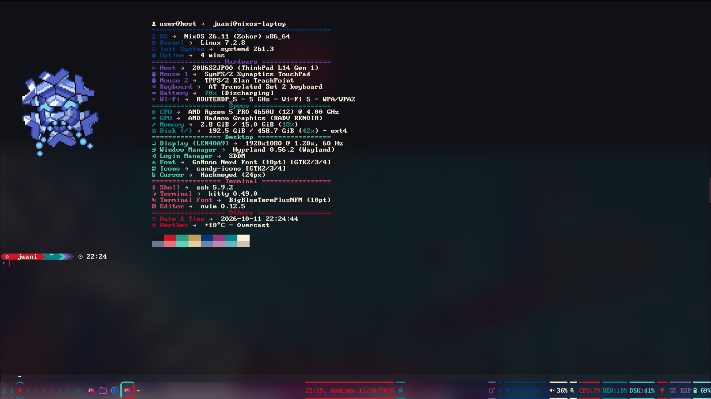
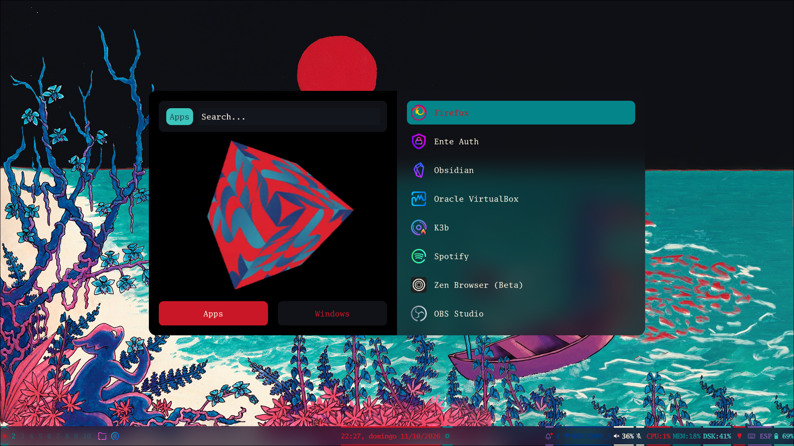
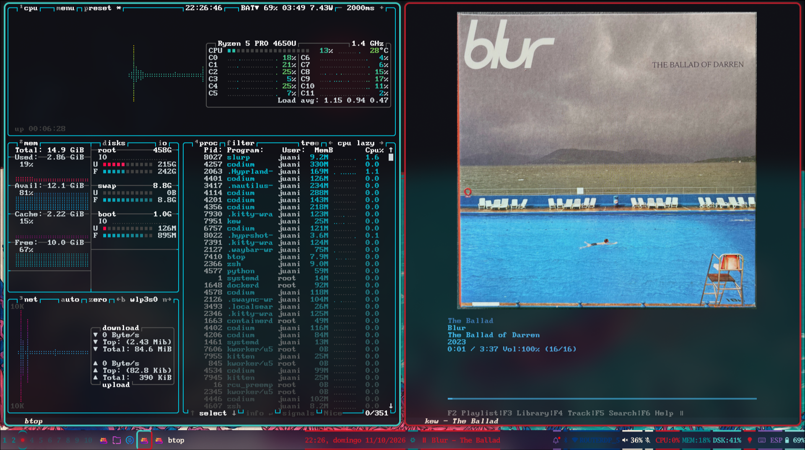
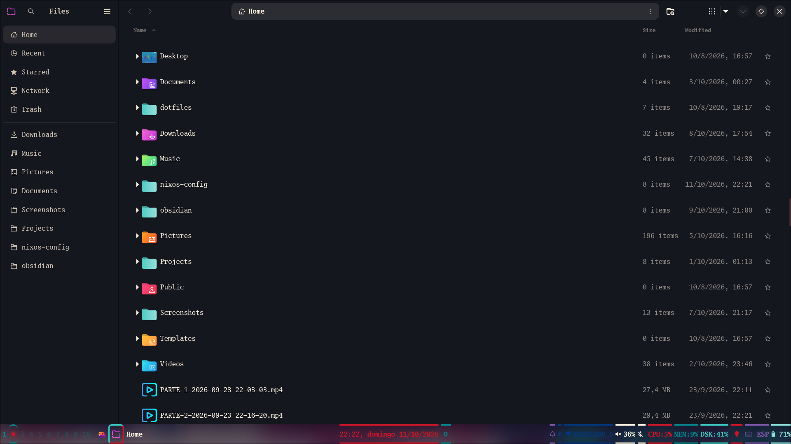
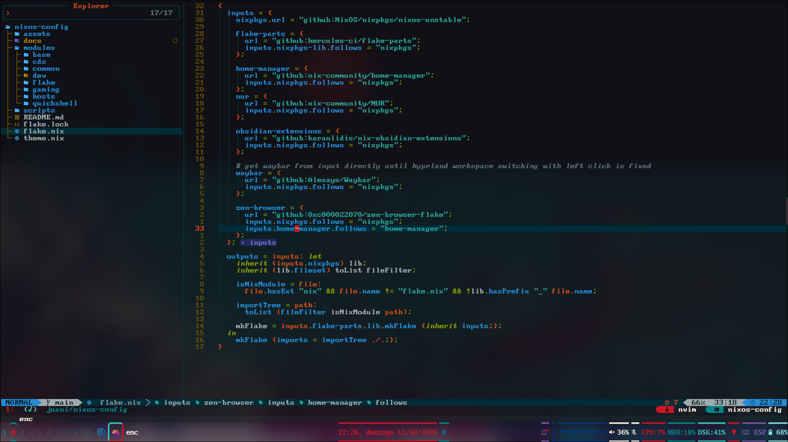

# nixos-config

Should have the following categories:

- common -> every machine, server included (user, locale and keyboard layout, nix settings)

- de -> includes:
  - desktop environment (hyprland) settings 
  - bar (waybar)
  - dmenu (rofi)
  - quickshell
  - cursor, font, gtk customization
  - other settings and customizations that show up on desktop use

- programs -> includes:
  - cli tools (terminal emulator and other related stuff)
  - browser, editor, file manager
  - other gui everyday use programs

- system -> includes:
  - boot settings
  - audio
  - user directories
  - other system settings

- shell -> includes:
  - shell (shell program, plugins and aliases)
  - tools that improve shell experience (zoxide, eza, bat)
  - shell prompt
  - aliases

- cds -> includes:
  - tools for ripping cds
  - tools for burning cds

- dev -> includes:
  - CLI dev tools (aws, terraform, gh, dotnet, dotenv)
  - IDE's (vscodium, jetbrains rider, etc)

- gaming -> includes:
  - steam and necessary tools to run games correctly
  - minecraft
  - drivers for GPU's

## Some pictures

### Desktop and waybar

### Terminal emulator - fastfetch

### Rofi menu

### Btop and Kew

### Nautilus

### Neovim with Lazyvim setup

